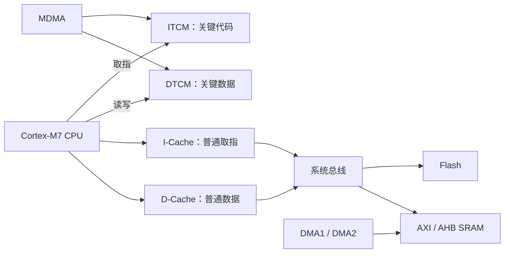

# TCM 与 Cache 详细教程：从 Cortex-M7 原理到 STM32H723 工程实践

适用对象：使用 STM32H723、STM32 HAL、CMSIS 和 C/C++ 的嵌入式开发者。本文以当前 `ZLLC_2027` 工程为例，资料核对日期为 2026-10-27。其他 Cortex-M7 芯片可以参考原理，但内存容量、总线连接和启动方式必须重新核对。

本文附带的代码位于 [Examples/TCM_Cache](Examples/TCM_Cache/README.md)，属于独立参考示例。现有固件的 Cache 开关、DMA 驱动和内存布局没有因本教程而修改。

阅读顺序：先理解第 1～5 节，再学习 TCM 放置与启动；使用 UART/SPI/ADC DMA 时，重点阅读第 8～11 节；最后用第 12～14 节检查当前工程与验证结果。

## 1. 先记住这六件事

1. **TCM 是实际的 RAM。** 程序和变量可以通过链接器放到指定 TCM 地址。
2. **Cache 是 CPU 自动管理的副本。** 普通 C 代码访问原地址，硬件决定命中、填充和替换；不能用链接脚本把变量“放到 D-Cache 地址”。
3. **ITCM 常放关键代码，DTCM 常放关键数据。** CPU 访问这些 TCM 时绕过 L1 Cache。
4. **DMA 能否访问目标内存，与数据是否一致，是两个问题。** 对一个不可达的地址做 Clean，也不能使 DMA 访问它。
5. **缓存区 DMA 的基本顺序：TX 启动前 Clean；RX 启动前 Invalidate，完成后再次 Invalidate。** 同时需要缓存行独占与缓冲区所有权。
6. **`volatile`、内存屏障、Cache 维护、线程同步各有用途，不能相互代替。**

第 3 点依据 [Arm Cortex-M7 TRM §5.7](https://documentation-service.arm.com/static/5e906d72c8052b1608760d63)，第 5 点依据 [ST 对 DMA 缓存一致性的说明](https://community.st.com/stm32-mpus-61/how-to-maintain-dcache-coherency-for-dma-on-stm32-devices-167548)。

## 2. TCM、Cache、普通 SRAM 有什么区别

| 比较项 | ITCM / DTCM | I-Cache / D-Cache | AXI / AHB SRAM |
|---|---|---|---|
| 本质 | 有地址的存储器 | 其他存储器内容的缓存副本 | 有地址的存储器 |
| 内容由谁安排 | 链接器、启动代码、应用 | 硬件自动填充和替换 | 链接器、启动代码、应用 |
| CPU 主要访问路径 | TCM 专用接口 | 命中时在核内；未命中时访问后端内存 | 系统总线，可能经过 Cache |
| 容量消耗 | 代码/数据实际占用 RAM | 占用缓存行，与工作集有关 | 代码/数据实际占用 RAM |
| 主要价值 | 关键路径的确定性与性能 | 提高大量普通访问的平均性能 | 较通用的容量与外设共享 |
| DMA 注意点 | 按控制器核对可达性 | 共享缓存区需要软件维护 | 可达性、MPU 属性、所有权 |
| 断电保留 | 不保留 | 不保留 | 普通 SRAM 不保留 |

可以把 Flash 看成存放程序原件的地方，TCM 是为选定代码/数据安排的专用工作空间，Cache 是硬件自动维护的近期副本。TCM 与 Cache 可以同时使用：关键 EKF 函数在 ITCM，其他函数继续由 Flash + I-Cache 加速。

下面是简化的数据路径，省略了仲裁、桥接与部分接口：



TCM 的低等待特性不等于“函数固定一个时钟完成”。分支、运算依赖、FPU、被调用函数、数据所在位置、中断抢占仍会影响耗时。选哪些函数进入 TCM，需要结合实际测量。[ST AN4891 系统架构与性能](https://www.st.com/resource/en/application_note/an4891-stm32h72x-stm32h73x-and-singlecore-stm32h74x75x-system-architecture-and-performance-stmicroelectronics.pdf) 给出了不同代码/数据放置的性能分析。

## 3. STM32H723 的内存地图

### 3.1 器件容量与当前链接器配置

表中 KB 按 1024 字节计算。“当前 GNU 配置”来自仓库的 `STM32H723VGTx_FLASH.ld`，不能据此反推芯片实际选项字节。

| 区域 | 起始地址 | H723 容量 | 当前 GNU 配置 | 典型用途 |
|---|---|---:|---:|---|
| Flash | `0x08000000` | VG 为 1024 KB | 1024 KB | 程序原件、常量、RAM 段的初值 |
| ITCM | `0x00000000` | 64～256 KB | 64 KB | 中断/控制/算法热点代码 |
| DTCM | `0x20000000` | 128 KB | 128 KB | CPU 专用工作区、部分栈 |
| AXI SRAM | `0x24000000` | 128～320 KB | 128 KB | 普通全局变量、堆、栈、合适的 DMA 缓冲 |
| D2 SRAM1 | `0x30000000` | 16 KB | 与 SRAM2 合并为 32 KB | DMA1/2 缓冲 |
| D2 SRAM2 | `0x30004000` | 16 KB | 同上 | DMA1/2 缓冲 |
| D3 SRAM4 | `0x38000000` | 16 KB | 16 KB | BDMA 等共享缓冲 |
| Backup SRAM | `0x38800000` | 4 KB | 未声明 | 满足供电条件时保存少量状态 |
| I-Cache | 无普通变量分配地址 | 32 KB | 硬件固定 | 指令副本 |
| D-Cache | 无普通变量分配地址 | 32 KB | 硬件固定 | 数据副本 |

H723 的容量以 [DS13313，首页、表 1 与 §3.3.2](https://www.st.com/resource/en/datasheet/stm32h723vg.pdf) 为准。注意：H743 常见的 Cache、D2 SRAM 和 SRAM4 容量不能直接套用；系列级应用笔记也应与具体器件数据手册交叉核对。

### 3.2 为什么 ITCM 和 AXI SRAM 的大小会变化

H723 有 192 KB RAM 可在 ITCM 与 AXI SRAM 之间分配：

| `TCM_AXI_SHARED[1:0]` | ITCM 总量 | AXI SRAM 总量 |
|---|---:|---:|
| `00` | 64 KB | 320 KB |
| `01` | 128 KB | 256 KB |
| `10` | 192 KB | 192 KB |
| `11` | 256 KB | 128 KB |

出厂值为 `00`。实际板子可能已修改过选项字节；链接脚本只声明编译器可以使用多大空间，不会重新分配硬件 RAM。配置表与出厂值见 [RM0468 表 8、表 18](https://www.st.com/resource/en/reference_manual/dm00603761-stm32h723733-stm32h725735-and-stm32h730-value-line-advanced-armbased-32bit-mcus-stmicroelectronics.pdf)。

可在已正常启动的程序/调试器中读取当前值，无须写选项字节：

```c
#include "stm32h7xx.h"

uint32_t ReadTcmAxiShared(void)
{
    return (FLASH->OPTSR2_CUR & FLASH_OPTSR2_TCM_AXI_SHARED_Msk)
           >> FLASH_OPTSR2_TCM_AXI_SHARED_Pos;
}
/* 函数返回 0/1/2/3，对照上表。 */
```

当前 GNU 链接器同时保守地声明 ITCM 64 KB、AXI SRAM 128 KB，未使用的 RAM 不会被自动合并。扩大任一链接区域前，应核实硬件分配、栈/堆边界以及所有构建配置。

## 4. Cache 怎样工作

### 4.1 Hit、Miss、Cache Line 与 Dirty

假设 CPU 从可缓存 SRAM 读取地址 `0x24000004`：

1. 查找对应缓存行的标记和有效位。
2. 命中（Hit）：从 Cache 返回数据。
3. 未命中（Miss）：从后端 RAM 取得相应行，再完成读取。

H723 Cortex-M7 的缓存行为单位为 **32 字节**。地址 `0x24000000`～`0x2400001F` 位于同一行，改其中一个字节会影响这一行的状态。D-Cache 为四路组相联，I-Cache 为两路组相联，硬件负责替换。[Arm Cortex-M7 TRM §5.8](https://documentation-service.arm.com/static/5e906d72c8052b1608760d63)

由此可算出：H723 的 32 KB D-Cache 有 1024 行、256 组；32 KB I-Cache 有 1024 行、512 组。不同地址即使总大小未超过 Cache，也可能竞争同一组，所以“数据总量小于 32 KB”不能保证没有 Miss。

写回策略下，CPU 修改缓存行后，这行可能比 RAM 新，称为 Dirty。被替换时，硬件可能把整条 Dirty 行写回 RAM。DMA 通常直接访问 RAM，不会自动查询 CPU 的 Dirty 行。

### 4.2 Write-through 与 Write-back

| 策略 | CPU 写入后的主要行为 | DMA 使用时的含义 |
|---|---|---|
| Write-through，直写 | 更新缓存时也把写事务送向后端内存 | 仍需处理写事务完成和 RX 旧缓存问题 |
| Write-back，写回 | 可以先只更新 Cache，稍后写回 | TX 前通常需要 Clean；RX 需妥善移交缓存行 |
| Non-cacheable，非缓存 | 该区域访问不保留在 D-Cache | 无需对该区域做 Clean/Invalidate，仍需同步 |

缓存策略由地址默认属性和 MPU 配置等共同决定。是否读/写分配，决定 Miss 时是否把该行装入 Cache，与 Write-back/Write-through 是不同维度。不要通过“关闭写回”推断所有 DMA 一致性问题都已解决。[ST AN4839](https://www.st.com/resource/en/application_note/an4839-level-1-cache-on-stm32f7-series-and-stm32h7-series-stmicroelectronics.pdf)

### 4.3 I-Cache 与 D-Cache 的分工

I-Cache 缓存指令取指；D-Cache 缓存数据访问。Flash 中的 `const` 表被当数据读取时，可能用到 D-Cache。打开 I-Cache 不会使 UART 接收数组进入 I-Cache。

I-Cache 没有需要写回的 Dirty 指令行，因此通常只谈 Invalidate。普通程序不修改已执行指令时，无须频繁清空 I-Cache。[CMSIS I-Cache API](https://arm-software.github.io/CMSIS_6/latest/Core/group__Icache__functions__m7.html)

## 5. Clean、Invalidate 和屏障

### 5.1 三种 Cache 维护操作

| 操作 | 做什么 | 常见用途 | 关键风险 |
|---|---|---|---|
| Clean | 把 Dirty 数据写回 RAM，缓存行仍可有效 | CPU 写完后交给 DMA 读 | CPU/DMA 同时改会有竞争 |
| Invalidate | 丢弃缓存行，下次 CPU 访问重新读取 | DMA 写完后交给 CPU 读 | Dirty 数据会丢失 |
| Clean + Invalidate | 先写回再丢弃 | 特定缓存策略切换、移交 | DMA RX 后可能把旧值写回覆盖新值 |

本地 CMSIS 的对应接口：

```c
SCB_CleanDCache_by_Addr((uint32_t *)addr, byte_count);
SCB_InvalidateDCache_by_Addr((void *)addr, byte_count);
SCB_CleanInvalidateDCache_by_Addr((uint32_t *)addr, byte_count);
```

长度单位是**字节**，不是 `uint32_t` 元素个数；地址应按缓存行处理。不同 CMSIS 版本的指针形参略有不同，本文完整示例已经按工程实际头文件编译检查。[CMSIS D-Cache API](https://arm-software.github.io/CMSIS_6/latest/Core/group__Dcache__functions__m7.html)

### 5.2 `volatile`、DMB、DSB、ISB 各管什么

| 手段 | 作用范围 | 不能代替什么 |
|---|---|---|
| `volatile` | 约束编译器对相应对象访问的优化 | 不会 Clean/Invalidate，也不提供互斥 |
| `__DMB()` | 对相关显式内存访问建立顺序 | 不会主动把所有 Dirty 行写回 |
| `__DSB()` | 等待此前相关访问/维护操作完成 | 不会自动发现需要清理哪些 Dirty 行 |
| `__ISB()` | 使后续取指反映新的执行上下文 | 不负责刷新普通数据缓存 |
| Mutex / 临界区 / 队列通知 | 管理任务或 ISR 的并发与所有权 | 不会使 Cache 与 DMA 自动一致 |

典型组合是：先通过所有权协议保证 CPU/DMA 不同时使用缓冲区，再做 Cache 维护及所需屏障，最后启动 DMA 或通知消费者。屏障语义参见 [PM0253 §2.3.4](https://www.st.com/resource/en/programming_manual/pm0253-stm32f7-series-and-stm32h7-series-cortexm7-processor-programming-manual-stmicroelectronics.pdf)。

```c
volatile uint8_t rx[128];  /* 仍可能是可缓存内存，不能以此解决 DMA 一致性。 */
```

## 6. 怎样把函数和变量放到 TCM

### 6.1 完整流程包含四个环节

```text
C/C++ 段属性 → 链接器分配地址 → 启动代码搬运/清零 → 程序开始使用
```

只加 `section()` 不够；只在 `MEMORY` 声明一块 ITCM 也不会自动把函数放进去。链接成功后还要确认实际使用的是哪套链接脚本，以及启动代码是否初始化了对应段。

### 6.2 当前工程已有的宏

本地 `User/Algorithm/Inc/ekf_tcm.h` 已定义：

```c
#if EKF_USE_TCM
#define EKF_ITCM_CODE __attribute__((section(".itcm_ekf")))
#define EKF_DTCM_DATA __attribute__((section(".bss.dtcm_ekf"), aligned(8)))
#else
#define EKF_ITCM_CODE
#define EKF_DTCM_DATA
#endif
```

使用形式：

```c
/* 示例，未额外加入当前固件。 */
static EKF_DTCM_DATA float work[36];  /* 零初始化工作区 */

EKF_ITCM_CODE float Sum6(const float *x)
{
    float sum = 0.0f;
    for (unsigned i = 0; i < 6; ++i) {
        sum += x[i];
    }
    return sum;
}
```

这里 `x` 指向哪里，数据就从哪里读取。把 `Sum6` 放进 ITCM，不会把调用者传入的数组自动搬进 DTCM。同理，把包含指针的结构体放进 DTCM，也不会移动其指向的堆内存。

### 6.3 VMA 与 LMA：运行地址和加载地址

TCM 是 RAM，断电后没有代码。通常应把函数的初始机器码存放在 Flash，上电时再复制到 ITCM：

```text
Flash：ITCM 函数的初始镜像（LMA）
                 │ 启动时复制
                 ▼
ITCM：函数实际执行地址（VMA）
```

GNU ld 中的 `> ITCMRAM AT> FLASH` 表示运行地址在 ITCM、加载镜像在 Flash。链接器据此生成地址和镜像，**实际复制由启动代码执行**。[GNU ld：Output Section LMA](https://sourceware.org/binutils/docs/ld/Output-Section-LMA.html)

当前链接脚本的关键内容可概括为：

```ld
.itcm_ekf :
{
    . = ALIGN(8);
    _sitcm_ekf = .;
    *(.itcm_ekf)
    *(.itcm_ekf.*)
    . = ALIGN(8);
    _eitcm_ekf = .;
} > ITCMRAM AT> FLASH
_siitcm_ekf = LOADADDR(.itcm_ekf);

.dtcm_ekf (NOLOAD) :
{
    . = ALIGN(8);
    _sdtcm_ekf = .;
    *(.bss.dtcm_ekf)
    *(.bss.dtcm_ekf.*)
    . = ALIGN(8);
    _edtcm_ekf = .;
} > DTCMRAM
```

自定义 DTCM 段必须先于会吞掉它的 `*(.bss*)` 匹配规则。否则带属性的工作区仍可能被普通 `.bss` 收走。

`NOLOAD` 表示不提供该段的加载内容，不等于“硬件自动清零”或“掉电保留”。自定义零初始化段需要启动代码显式清零；带非零初值的变量应另设有 Flash 镜像的段并复制。[GNU ld：Output Section Type](https://sourceware.org/binutils/docs/ld/Output-Section-Type.html)

### 6.4 启动顺序与 ECC

当前 GNU 启动汇编 `startup_stm32h723xx.s` 已完成：

1. 设置栈并调用 `SystemInit()`。
2. 将 `SCB->VTOR` 指向实际 Flash 向量表。
3. 保留原控制字段，仅置位 ITCM/DTCM 的使能位，执行屏障。
4. 从 `_siitcm_ekf` 复制到 `_sitcm_ekf`～`_eitcm_ekf`。
5. 清零 `_sdtcm_ekf`～`_edtcm_ekf`。
6. 初始化普通 `.data` / `.bss`，调用 `__libc_init_array()`，进入 `main()`。

不能让 TCM 函数、全局对象构造函数在搬运完成前执行。写入 ITCM 地址 0 后，也不能继续依赖该地址曾经存在的启动别名向量表。

当前启动代码用 64 位写入初始化 ITCM，并在段末做 8 字节对齐。自写搬运函数时需要考虑 ECC 粒度，避免一开始就对未初始化的 ECC 存储单元做窄写/读改写。TCM 和 AXI RAM 的 ECC 与 Cache 自身的 ECC 是不同层面；对应器件说明见 [DS13313 §3.3.2](https://www.st.com/resource/en/datasheet/stm32h723vg.pdf)。

通用的“ITCM 代码 + DTCM 初值 + DTCM 清零 + DMA 区”参考实现见 [示例目录说明](Examples/TCM_Cache/README.md)。它用于理解或移植新段；现有 EKF 段已经初始化，不应再加一套重复搬运逻辑。

### 6.5 Keil / ArmClang 与 GNU 的区别

GNU 工程使用 `.ld` 和本地 GNU 启动汇编；Keil / ArmClang 通常使用 scatter 文件 `.sct` 和 `__main` 的 scatter-loading 初始化机制。段属性的名字可以相同，链接和初始化机制不同。

检查 TCM 是否生效时，应同时看当前链接命令、实际 `.ld/.sct`、本次 `.map`、函数运行地址。项目目录中历史生成的同名文件不能证明当前构建行为。不要直接把 GNU 的启动符号和拷贝循环粘贴进另一套启动流程。

## 7. 正确开启和关闭 Cache

在 DMA 尚未启动、CPU 没有需要保留的旧缓存状态时配置 MPU，然后用 CMSIS 开启 Cache：

```c
/* 启动阶段示意：MPU 函数选择见附带示例。 */
/* Configure_MPU_Before_DCache(); */
SCB_EnableICache();
SCB_EnableDCache();
HAL_Init();
```

当前仓库 `main.c` **已经开启 I-Cache，但没有开启 D-Cache**。因此上面只是展示顺序，不能直接视作对现有 DMA 驱动的修改建议。

工程的 `Drivers/CMSIS/Include/core_cm7.h` 中，`SCB_EnableDCache()` 会先按 Set/Way Invalidate，再使能并执行屏障；`SCB_EnableICache()` 也有相应初始化。使用这套标准实现无需先重复全 Cache Invalidate。不要上电后先对未初始化的 Cache 执行 Clean；缓存 ECC 尚未初始化时可能出现故障。[ST DMA FAQ](https://community.st.com/stm32-mcus-60/dma-is-not-working-on-stm32h7-devices-97)

需要关闭 D-Cache 时，应停止相关并发访问并使用：

```c
if ((SCB->CCR & SCB_CCR_DC_Msk) != 0U) {
    SCB_DisableDCache();
}
```

本地实现包含 Clean + Invalidate，不应直接清 `CCR.DC` 代替它。运行中改变 MPU 缓存属性也需要先处理旧缓存状态；本教程的 MPU 示例仅用于启动阶段。

H723 勘误涉及某些缺屏障的 Cache 维护序列，使用项目现有 CMSIS API 并保留其屏障比自行写维护寄存器更稳妥。[ES0491 §2.1.4](https://www.st.com/resource/en/errata_sheet/es0491-stm32h72xx73xx-device-errata-stmicroelectronics.pdf)

## 8. DMA 一致性：先检查能不能访问

以下表格仅比较常用片内 RAM，不能据此推导所有外设、Flash 和跨域路径均可访问：

| RAM | CPU | DMA1 / DMA2 | BDMA | MDMA |
|---|---|---|---|---|
| ITCM / DTCM | 可以 | **不可以** | 不可以 | 可以，经 AHBS |
| AXI SRAM | 可以 | 可以 | 不可以 | 可以 |
| D2 SRAM1 / SRAM2 | 可以 | 可以 | 不可以 | 可以 |
| D3 SRAM4 | 可以 | 可以 | 可以 | 可以 |

依据 [ST AN4891 总线连接说明与表 4](https://www.st.com/resource/en/application_note/an4891-stm32h72x-stm32h73x-and-singlecore-stm32h74x75x-system-architecture-and-performance-stmicroelectronics.pdf)。具体操作还必须满足域电源、RAM 时钟、DMA 请求路由和传输宽度等要求。

例如，UART 使用 DMA1，但接收数组实际在 `0x2000xxxx` 的 DTCM。即使 D-Cache 关闭、数组 `volatile`、调用多次 Invalidate，也不能解决 DMA1 不可达的问题。

常见的数据路径可以这样安排：

```text
UART / SPI / ADC → DMA 可达 SRAM 缓冲 → CPU 读取/解析 → DTCM 算法工作区
```

CPU 拷贝增加一些开销，但可以把通信缓冲和算法内部数据的所有权分开。是否改用 MDMA 中转，需要评估数据量和控制复杂度。

## 9. DMA 一致性：再检查数据是不是同一份

本节假设 D-Cache 已开启、缓冲区可缓存、使用 Write-back 策略、缓冲区独占缓存行。

### 9.1 TX：CPU 写，DMA 读

错误顺序：CPU 把发送字节写进 Cache，RAM 里仍是旧值；DMA 从 RAM 读取，发出了旧数据。

正确顺序：

```text
CPU 获得发送缓冲区
    → CPU 填充
    → Clean 覆盖范围，完成屏障
    → 启动 DMA
    → DMA / 外设完成
    → CPU 才能修改、释放或再次使用缓冲区
```

DMA 启动函数返回 `HAL_OK` 只表示成功启动。局部栈数组在函数返回后失效、缓冲区提前复用、任务修改正在发送的数组，即使 Clean 调用完全正确也会出错。

### 9.2 RX：DMA 写，CPU 读

需要两次 Invalidate：

```text
CPU 停止使用接收缓冲区
    → 启动前 Invalidate，丢弃旧 Dirty/旧有效行
    → 启动 DMA
    → DMA 持有缓冲区，CPU 不读写
    → 确认传输完成或已停止且内存写入完成
    → 完成后 Invalidate
    → CPU 解析或复制数据
```

第一次防止旧 Dirty 行在 DMA 期间被换出并覆盖新数据；第二次移除传输期间可能装入的旧缓存，包括推测访问带来的缓存内容。[ST DMA 一致性说明，第 1、4、5 节](https://community.st.com/stm32-mpus-61/how-to-maintain-dcache-coherency-for-dma-on-stm32-devices-167548)

RX 完成后不要随意改成 Clean + Invalidate：旧 Dirty 缓存可能被写回，覆盖 DMA 刚写入的 RAM。对独占整行、旧内容可以丢弃的 RX 缓冲，采用前后 Invalidate 更容易明确责任。

如果同一缓冲区中有必须保留的旧 CPU 数据，启动前可以在适当条件下 Clean + Invalidate；但部分传输、共享行和并发访问需要另外设计，不能靠增加一次 Clean 自动修复。

### 9.3 SPI 全双工

分离 TX / RX 缓冲区，各自独占缓存行：

```text
填 TX → Clean TX → Invalidate RX → 启动 TxRx DMA
                                         │
                          完成后 Invalidate RX → 处理 RX
```

不要把 RX 和还在被 DMA 读取的 TX 放在同一条缓存行，也不要在未分析外设读写顺序时使用同一个地址原地收发。

## 10. 32 字节对齐为什么还不够

### 10.1 起始地址和实际分配长度都要考虑

假设需要接收 67 字节，应保留 96 字节独立存储空间：

```c
#include <stdint.h>

#define CACHE_LINE_BYTES 32U
#define RX_PAYLOAD_BYTES 67U
#define RX_STORAGE_BYTES 96U

/* 还需由链接器放入 DMA 可达 RAM。 */
static uint8_t rx[RX_STORAGE_BYTES]
    __attribute__((aligned(CACHE_LINE_BYTES)));

_Static_assert((RX_STORAGE_BYTES % CACHE_LINE_BYTES) == 0U,
               "RX storage must own complete cache lines");
```

DMA 的有效长度仍可以是 67 字节；Cache 维护可以覆盖整个专用的 96 字节空间。尾部 29 字节属于预留空间，不能放其他变量。

### 10.2 地址取整只解决“覆盖范围”

对原始区间 `[addr, addr + len)`，常见计算是：

```text
start = addr 向下对齐 32
end   = addr + len 向上对齐 32
维护 [start, end)
```

例如 `[0x24000013, 0x2400003B)` 需要覆盖 `[0x24000000, 0x24000040)`。如果边缘缓存行含其他对象的 Dirty 数据，Invalidate 可能把它们丢掉。**取整不能创造缓存行独占。**

自行编写范围函数还要处理 `len == 0`、整数溢出和 CMSIS 的 `int32_t` 长度上限。附带示例选择更容易审查的约束：专用 D2 缓冲、起始地址 32 字节对齐、存储空间整行，直接拒绝不满足条件的范围。

### 10.3 结构体和数组的隐蔽问题

```c
struct Packet {
    uint8_t data[128];
    uint16_t len;
};

static struct Packet q[4] __attribute__((aligned(32)));
```

整个 `q` 对齐，并不代表 `q[1].data` 也对齐：元素步长通常是 130 字节。可以使用独立的二维整行数组保存 DMA 数据，元数据单独保存；也可以对齐类型并用 `sizeof` / `offsetof` 静态断言验证布局。

同样，在结构体前面放一个 4 字节指针，后面的 128 字节 RX 数组就可能偏离缓存行边界。判断依据应是成员实际地址与跨度，而不只是数组长度。

### 10.4 环形 DMA 与半传输

循环 DMA 中，半传输/传输完成回调不表示整个缓冲区都归 CPU。正确做法是按块移交所有权：

```text
DMA 写 A 块时，CPU 处理已完成的 B 块；
DMA 写 B 块时，CPU 处理已完成的 A 块。
```

每块起始地址、块大小都应满足缓存行独占。例如 16 位 ADC，半块包含 `N` 个样本，则应使 `2 * N` 为 32 的倍数。CPU 必须在 DMA 绕回覆盖该块前完成处理。

UART IDLE / ReceiveToIdle 还需分辨事件类型、正常/循环模式、实际写入区间与是否停止。不能在 DMA 正写另一半时，对整个活动缓冲做 Clean 或当作普通一次性 RX 处理。小块连续通信可考虑下一节的 MPU 非缓存区，并继续保留所有权协议。

## 11. 另一种方案：MPU 划出非缓存 DMA 区

### 11.1 链接器与 MPU 必须配合

一种便于入门的布局是：D2 的 32 KB 全部预留给 DMA，其他 SRAM 保持原有策略。先由链接器把 `.dma_buffer` 放到 `0x30000000`～`0x30007FFF`，再由 MPU 把同一区间设置为 Normal、Non-cacheable、XN。

关键属性组合：

```c
MPU_InitStruct.TypeExtField = MPU_TEX_LEVEL1;           /* TEX = 1 */
MPU_InitStruct.IsCacheable = MPU_ACCESS_NOT_CACHEABLE;  /* C = 0 */
MPU_InitStruct.IsBufferable = MPU_ACCESS_NOT_BUFFERABLE;/* B = 0 */
MPU_InitStruct.IsShareable = MPU_ACCESS_SHAREABLE;
MPU_InitStruct.DisableExec = MPU_INSTRUCTION_ACCESS_DISABLE;
```

TEX/C/B 要按完整编码理解。`TEX=0,C=0,B=0` 不是同一种 Normal 非缓存属性。Shareable 也不是 DMA 自动嗅探或硬件缓存一致性的开关。MPU 属性与区域优先级参见 [AN4838](https://www.st.com/resource/en/application_note/an4838-introduction-to-memory-protection-unit-management-on-stm32-mcus-stmicroelectronics.pdf) 和 [CMSIS MPU API](https://arm-software.github.io/CMSIS_6/latest/Core/group__mpu__functions.html)。

### 11.2 配置约束

1. 在 D-Cache 尚未开启、DMA 未启动时配置。
2. Cortex-M7 MPU 区域大小使用 2 的幂，基地址按区域大小对齐；32 KB 区域从 `0x30000000` 开始满足要求。
3. 确认区域编号未被其他配置占用，重叠时以更高编号区域为准。
4. 链接器真实预留整块空间，防止普通堆/栈/全局变量与 DMA 区重叠。
5. 使用 SRAM1/2 前开启对应时钟；`NOLOAD` 区域在首次使用前按合适宽度初始化。
6. 普通非 MPU FreeRTOS 端口与 MPU 端口的特权/背景区域策略不同，不能直接假定所有任务都可访问背景区。

完整配置见附带 MPU 示例。不要在已经使用缓存的区域上直接切换属性；运行中切换需要停止访问、维护旧缓存和执行屏障，本例不覆盖这种迁移。

### 11.3 两种方案怎样选

| 场景 | 可考虑的安排 |
|---|---|
| 数据量小、通信频繁、循环 RX | 独立 MPU 非缓存 DMA 区 |
| 大块数据、CPU 后处理较多 | 缓存区 + 严格按块维护，实际测量收益 |
| CPU 专用算法状态和矩阵 | DTCM |
| 紧迫、较稳定的计算/控制代码 | ITCM |
| 普通业务代码 | Flash + I-Cache |

MPU 非缓存减少了 Cache 维护责任，但 CPU 访问可能变慢，也不能解决 DMA 不可达或缓冲区竞争。同一缓冲区选择一种清晰策略；本教程附带的 UART 代码展示手动维护路径，MPU 配置展示可替代的内存策略。

## 12. 如何应用到当前工程

### 12.1 已经存在的 TCM 实现

| 文件 | 当前职责 |
|---|---|
| `User/Congfig/Inc/config.h` | `EKF_USE_TCM` 默认值为 1 |
| `User/Algorithm/Inc/ekf_tcm.h` | ITCM / DTCM 段宏、`EKF_Timing` 定义 |
| `User/Algorithm/Src/kalman_filter.cpp` | DTCM 静态工作区、部分 ITCM 计算路径 |
| `User/Algorithm/Src/QuaternionEKF.cpp` | EKF 更新及相关函数的 ITCM 标记 |
| `STM32H723VGTx_FLASH.ld` | GNU TCM 段、VMA / LMA 和边界符号 |
| `startup_stm32h723xx.s` | GNU TCM 使能、搬运与清零 |
| `Core/Src/main.c` | 开启 I-Cache；未开启 D-Cache |

宏为 1 表示选择了带 TCM 属性的实现，最终位置仍由本次链接决定。当前目录同时存在 GNU、Keil、EIDE 配置；应检查实际链接命令与本次产物。已有历史 Keil map 中能看到 TCM 执行区，不代表其他构建入口采用相同布局。

### 12.2 开启 D-Cache 前要改的通信边界

当前 `drv_uart.h` 的 `Struct_UART_Manage_Object` 将句柄、TX、RX 和元数据放在同一结构体中；数组虽然各为 128 字节，但没有完整的缓存行布局约束。仅把结构体整体对齐到 32 字节，仍不足以对齐其中的 RX 成员。

`drv_uart.cpp` 会在接收路径中把 RX 内容复制到消息队列。若采用可缓存 DMA 区，完成后的 Invalidate 应发生在**第一次读取 RX 的 memcpy/解析之前**，而不是等任务消费消息时再补做。每次重新交给 DMA 前也需要相应准备。

`drv_spi.h` 的管理结构体也应审查 TX/RX 成员的实际地址和相邻元数据。正在使用循环接收的 UART 通道需要单独设计块边界，不能直接套用本教程的一次性 UART 示例。

建议实施顺序：

1. 保持当前固件可运行，记录 EKF 和通信基线。
2. 统一确认当前构建入口、链接器和 RAM 实际分配。
3. 为 DMA 缓冲区选择专用内存策略与存储生命周期。
4. 拆分/对齐缓冲区，处理开始、完成、失败、终止、循环事件和任务通知。
5. 开启 D-Cache，进行压力通信与算法结果验证。

这些是后续固件改造步骤，本文没有擅自执行该改造。

## 13. 怎样验证 TCM 和 Cache 的效果

### 13.1 先验证放置结果

对 GNU ELF 可使用以下 PowerShell 命令；文件名按实际本次构建产物调整：

```powershell
& 'C:/Users/a/.eide/tools/gcc_arm/bin/arm-none-eabi-objdump.exe' -h 'D:/.RMUC_2027/ZLLC_2027/build/Sentry.elf'
& 'C:/Users/a/.eide/tools/gcc_arm/bin/arm-none-eabi-nm.exe' -n 'D:/.RMUC_2027/ZLLC_2027/build/Sentry.elf'
```

应确认：

- `.itcm_ekf` 的 VMA 在 ITCM，LMA 在 Flash，大小没有越界。
- `.dtcm_ekf` 和工作区符号在 `0x2000xxxx`。
- Flash 镜像中包含 ITCM 段初始内容，冷启动时确实复制成功。
- `.dma_buffer` 在所选 DMA 能访问的区域，地址和容量符合约定。
- map/ELF 来自本次构建，编译优化、LTO 和链接垃圾回收没有改变预期路径。

Cortex-M 的函数指针可能带 Thumb 位，检查代码地址时要区分该最低位与存储位置。还可以在调试器中反汇编关键函数，确认 PC 和被调用函数的位置。

必须测试一次断电后独立启动：调试器可能预先写 RAM，使遗漏的启动搬运在调试时不易暴露。

### 13.2 使用 DWT 测量

当前工程已有 DWT 支持和 `EKF_Timing`，优先复用。以下是独立工程的最小测量示意，不要在当前工程重置正在被其他模块使用的 CYCCNT：

```c
#include "stm32h7xx.h"

static void DWT_StartForStandaloneBenchmark(void)
{
    CoreDebug->DEMCR |= CoreDebug_DEMCR_TRCENA_Msk;
    DWT->CYCCNT = 0U;
    DWT->CTRL |= DWT_CTRL_CYCCNTENA_Msk;
}

typedef struct {
    uint32_t cycles;
    float us;
} BenchmarkResult;

/* 仅用于独立测试工程；algorithm 非空、SystemCoreClock 已正确更新。
 * 先确认具体芯片/调试配置允许访问计数器。 */
BenchmarkResult BenchmarkOnce(void (*algorithm)(void))
{
    DWT_StartForStandaloneBenchmark();
    __DSB();
    __ISB();
    uint32_t begin = DWT->CYCCNT;
    algorithm();
    __DSB();
    uint32_t elapsed_cycles = DWT->CYCCNT - begin;
    BenchmarkResult result = {
        elapsed_cycles,
        (float)elapsed_cycles * 1000000.0f / (float)SystemCoreClock
    };
    return result;
}
/* 在正常应用函数内调用：
 * BenchmarkResult measured = BenchmarkOnce(Algorithm_Update);
 * 待测函数需匹配 void Algorithm_Update(void)，并实际使用运算结果。 */
```

若需要比较“所有内存写入均完成”的边界，开始采样前也加入相应屏障，并对空测量开销做基线评估。确保待测结果被实际使用，防止优化器删除计算。DWT 与屏障寄存器说明见 [PM0253](https://www.st.com/resource/en/programming_manual/pm0253-stm32f7-series-and-stm32h7-series-cortexm7-processor-programming-manual-stmicroelectronics.pdf)。

无符号相减可处理一次回绕，要求间隔小于整个计数周期。480 MHz 下 32 位计数器约 8.95 秒回绕；`SystemCoreClock` 必须与真实 CPU 时钟一致。

### 13.3 做有解释力的对比

| 方案 | 代码位置 | 数据位置 | I-Cache | D-Cache |
|---|---|---|---|---|
| A | Flash | AXI SRAM | 开 | 关 |
| B | ITCM | AXI SRAM | 开 | 关 |
| C | ITCM | DTCM | 开 | 关 |
| D | Flash | AXI SRAM | 开 | 开 |

比较时保持算法输入、优化选项和频率一致；D 方案必须先完成 DMA 一致性处理。记录最小、平均、最大值及样本数；Cache 冷态和预热后分开统计。是否允许中断抢占应明确写出，不能把含抢占的最大耗时直接当纯函数执行时间。

当前 `EKF_Timing` 中有 `sample_count`、`last_cycles`、`last_us`、`avg_us`、`min_us`、`max_us`，且保留正常中断。切换宏后重新构建、下载，再以相同条件采样。TCM 的收益需要在板上测量，本文不提供虚构加速比。

### 13.4 验证数据正确性

DMA 验证应包含递增计数/序号、校验和、不同有效长度、连续传输和并发负载。尤其检查 1、31、32、33、67、128 字节这类边界，以及忙/错误/终止后能否安全恢复。

算法验证应比较相同输入下输出与工作区行为。仓库已有 `Tools/check_ekf_tcm.py`，可在主机验证两种 EKF 路径的数值和工作区约束；它不能验证 STM32 真实 TCM 地址、缓存一致性或运行时间。

## 14. 常见故障排查

| 现象 | 优先排查 |
|---|---|
| 加了段属性，函数仍在 Flash | 本次链接脚本、输入段匹配、优化/内联、旧 map |
| 调用 TCM 函数立即 HardFault | 接口使能、复制顺序、VMA/LMA、ECC、执行权限、越界 |
| 调试器下正常，断电启动失败 | RAM 被调试器预加载、遗漏段复制/清零、VTOR |
| DMA 完全不搬运或报传输错误 | 控制器可达性、RAM 时钟、请求、宽度、长度与地址 |
| D-Cache 关闭正常，开启后读旧数据 | 完成前访问、缺 Invalidate、维护位置晚于首次读取 |
| RX 内容偶发被旧值覆盖 | 缺前置 Invalidate、CPU 并发写、RX 后误 Clean |
| 其他变量莫名变化 | RX 与元数据共用缓存行、Invalidate 丢弃相邻 Dirty 数据 |
| TX 内容前段正确后段变化 | 异步生命周期、栈数组失效、发送完成前修改 |
| 环形接收开 Cache 后不稳定 | 半块不整行、活动区被维护、消费者没赶上写指针 |
| MPU 配置后 MemManage/HardFault | 区域对齐/大小、优先级、权限、背景区、错误 TEX/C/B |
| 全 Cache Invalidate 后随机崩溃 | 栈/堆 Dirty 数据被丢弃；禁止用它作常规 RX 修复 |
| TCM 后平均值变化小 | 原代码已命中 Cache、热点不在搬运函数、数据仍在远端 |

发生 Fault 时保存 `SCB->CFSR`、`HFSR`、`BFAR`、`MMFAR` 和异常栈里的 PC/LR；使用 BFAR/MMFAR 前检查对应有效位。先用 PC 定位实际访问，再结合链接地址和控制器可达性判断。

## 15. 附带代码与资料

完整可编译参考代码及其集成步骤见 [Examples/TCM_Cache/README.md](Examples/TCM_Cache/README.md)。示例包括缓存行检查和 DMA 维护、一次性 UART DMA 生命周期、启动期 MPU 配置、GNU 段布局与 TCM 初始化。

建议查阅原文时按问题选择：

| 问题 | 一手资料 |
|---|---|
| H723 容量与器件特性 | [DS13313](https://www.st.com/resource/en/datasheet/stm32h723vg.pdf) |
| 地址、选项字节与 DMA 总线 | [RM0468](https://www.st.com/resource/en/reference_manual/dm00603761-stm32h723733-stm32h725735-and-stm32h730-value-line-advanced-armbased-32bit-mcus-stmicroelectronics.pdf) |
| TCM/Cache 内核细节 | [Arm Cortex-M7 TRM](https://documentation-service.arm.com/static/5e906d72c8052b1608760d63) |
| Cache 维护 API | [CMSIS D-Cache](https://arm-software.github.io/CMSIS_6/latest/Core/group__Dcache__functions__m7.html)、[CMSIS I-Cache](https://arm-software.github.io/CMSIS_6/latest/Core/group__Icache__functions__m7.html) |
| MPU 内存属性 | [AN4838](https://www.st.com/resource/en/application_note/an4838-introduction-to-memory-protection-unit-management-on-stm32-mcus-stmicroelectronics.pdf) |
| 体系结构与内存放置性能 | [AN4891](https://www.st.com/resource/en/application_note/an4891-stm32h72x-stm32h73x-and-singlecore-stm32h74x75x-system-architecture-and-performance-stmicroelectronics.pdf) |
| 缓存一致性维护顺序 | [ST 2026 年说明](https://community.st.com/stm32-mpus-61/how-to-maintain-dcache-coherency-for-dma-on-stm32-devices-167548) |
| H723 相关硬件勘误 | [ES0491](https://www.st.com/resource/en/errata_sheet/es0491-stm32h72xx73xx-device-errata-stmicroelectronics.pdf) |

ST 2026 年一致性说明中的示例来自 STM32MP2，本文仅引用其所有权与维护原则；H723 的具体 API、MPU 编码和地址以本工程 CMSIS/HAL 与 H723 手册为准。
