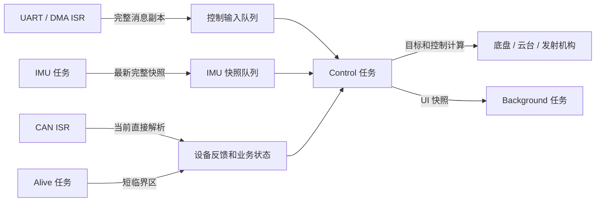

# 征龙凌沧27赛季嵌入式代码框架使用说明

本工程基于 STM32H723VGTx，由上赛季 `ZLLC_2026` 裸机框架演进而来。保留原有驱动、设备、算法、底盘/云台/发射机构与整车交互分层，主要调整任务调度、数据交接、通信恢复和调试工具。

对比基准为上赛季裸机工程 [ZLLC_2026（M65 分支）](https://github.com/ZLLC-NEUQ/ZLLC_2026/tree/M65)。本文更新于 2026-10-30；表格中的“当前实现”描述已有代码，“后续建议”描述下一步开发约定，尚未实现的能力不作为框架现有保证。

阅读顺序：[开始使用](#开始使用) → [与上赛季框架的主要对比](#与上赛季框架的主要对比) → [代码基本架构](#代码基本架构) → [测试与诊断工具的使用](#测试与诊断工具的使用) → [后续开发与书写规范](#后续开发与书写规范)。

## 开始使用

1. 打开 [ZLLC_2027.code-workspace](ZLLC_2027.code-workspace)，确认准备编译和烧录的是底盘板还是云台板。
2. 在 [config.h](User/Congfig/Inc/config.h) 中选择角色；`Congfig` 是工程现有目录拼写。`CHASSIS` 和 `GIMBAL` 每次只启用一个。
3. 核对所选构建入口、链接配置和输出目录。切换角色或宏后重新编译，烧录和调试使用同一次构建的产物。
4. 首次调试建议开启性能统计，观察任务频率、控制超时、栈/堆余量，再进行控制参数和功能调整。

云台配置示例：

```c
//#define CHASSIS
#define GIMBAL
```

| 配置 | 用途与当前实现 |
| --- | --- |
| `PERFORMANCE_TEST_ENABLE` | 默认 1；0 裁剪耗时、频率、栈/堆等测试插桩，不裁剪业务时基、任务及通信恢复 |
| `EKF_USE_TCM` | 默认 1；选择带 ITCM 段属性的算法及 DTCM 静态工作区，0 回到原 Flash/动态分配路径 |
| I-Cache | [main.c](Core/Src/main.c) 已开启，普通 Flash 取指由硬件自动缓存 |
| D-Cache | 当前未开启，通信缓冲区尚未完成统一的缓存一致性改造 |

两个数值宏支持编译参数 `-D宏名=0/1` 覆盖。宏为 1 只能说明选择了对应代码路径，TCM 实际地址还必须看本次 map。

| 构建入口 | 配置与注意点 |
| --- | --- |
| Keil uVision | [ZLLC_2027.uvprojx](MDK-ARM/ZLLC_2027.uvprojx)，明确使用 [ekf_tcm.sct](MDK-ARM/ekf_tcm.sct)，输出在 `MDK-ARM/output/` |
| MDK 目录 EIDE | [配置文件](MDK-ARM/.eide/eide.yml) 中明确使用 `ekf_tcm.sct`；产物路径以目标配置为准 |
| 根目录 EIDE | [配置文件](.eide/eide.yml) 当前未启用自定义 scatter，`scatterFilePath` 为空；不能直接认定与 MDK 的 TCM 布局相同 |

根目录 EIDE 常用输出为 `build/ZLLC_2027/`，与 MDK 输出可能属于不同角色、不同时间或不同链接布局。需要 TCM 时，先确认实际链接命令和执行区；不要用另一个目录的旧 `.map/.axf` 解释当前板上的行为。VS Code 构建入口见 [tasks.json](.vscode/tasks.json)。

## 与上赛季框架的主要对比

上赛季的分层接口、设备封装和控制算法仍是当前框架的基础。改造重点是让执行上下文、数据交接、故障恢复和性能开销更容易确定及观察。

| 改进方向 | 上赛季裸机框架 | 当前 27 赛季框架 | 收益与需要承担的成本 |
| --- | --- | --- | --- |
| 调度方式 | TIM4/TIM5 中断执行周期工作，主循环执行 `Task_Loop()` | 原生 FreeRTOS 分为 IMU、Control、Alive、Background 任务 | 周期和优先级更明确；增加任务栈、调度和同步成本，并不自动保证更快 |
| UART 接收 | DMA/IDLE 回调中直接解析遥控器并触发控制策略 | ISR 复制完整消息入队，控制任务解析，每轮设置消息处理预算 | 限制 ISR 工作量，减少解析与控制计算穿插；需要队列空间并处理满队列丢帧 |
| 数据交接 | IMU、控制和 UI 较多直接访问同一对象 | IMU 和 UI 用完整快照交接，计算态与消费态分离 | 减少半更新状态被读取； |
| 在线检测 | 在线扫描和遥控存活状态机集中在 TIM5 回调 | 独立 Alive 任务：1ms 状态机、50ms 基础扫描及设备分频 | 与控制计算分开维护；共享状态仍需同步，不能只新建任务后直接并发读写 |
| 错误恢复 | 已有 CAN Bus-Off 重启及遥控状态机中的 UART 重启，恢复入口较分散 | 错误 ISR 请求恢复，任务统一处理，加入待恢复标志、诊断和失败重试 | 恢复过程更可观察，避免 ISR 内等待； |
| 调试工具 | 各文件散放 DWT 临时变量及测时代码 | Device 性能模块统一耗时、频率、复位、栈/堆余量和超周期统计 | 方便对比和裁剪； |
| 热路径与内存 | 主要使用普通 Flash 和原动态算法工作区 | I-Cache 开启；EKF 可使用 ITCM 热函数和 DTCM 实际工作数组 | 改善选定计算路径；占用专用 RAM，并依赖正确链接和启动初始化 |
| 工程维护 | 生成代码、应用入口和构建规则较依赖人工经验 | 原生 RTOS 配置、优先级及检查工具集中管理 | 有利于再生成和回归检查； |

对比时需保留三个事实：

- 原 TIM4/TIM5 的实际配置也是 1ms，不能因 `Task_100us_Fast` 的历史名称，把本次改造描述为从 100µs 改到 1ms。
- 当前 CAN 仍在 ISR 直接解析（为了减少延迟），并未完成所有通信的任务化；USB 上位机解析也未接通。
- 上赛季已有错误恢复但不全，当前改进在于恢复的上下文、统一入口、失败处理和诊断。

原裸机框架调度直观、运行开销低、分层接口清楚，这些优点应继续保留。后续新增功能优先复用现有设备接口和任务，不必为每个设备都新建任务。

## 代码基本架构

### 分层与文件职责

| 层次 | 路径 | 负责什么 | 新代码建议放置位置 |
| --- | --- | --- | --- |
| 生成及板级入口 | `Core/`、`USB_DEVICE/` | 时钟、外设初始化、IRQ 和 USB HAL 接口 | CubeMX 生成配置及必要的 USER CODE 入口 |
| Driver | `User/Driver/` | UART/CAN/SPI/TIM、DMA 启动、总线回调和恢复服务 | 通用硬件收发、状态及错误处理 |
| Device | `User/Device/` | 电机、遥控器、IMU、裁判系统、上位机等设备协议 | 协议解析、设备状态、单位换算和设备级接口 |
| Algorithm | `User/Algorithm/` | PID、EKF、矩阵和公共计算 | 与具体业务流程分开的算法 |
| Chariot | `User/Chariot/` | 底盘、云台、发射机构各模块控制 | 模块目标处理、限幅和控制计算 |
| Interaction | `User/Interaction/` | 活动控制器、整车模式、输入策略及存活状态机 | 遥控输入如何转换成各模块目标和模式 |
| Task | `User/Task/` | 对象绑定、任务创建、周期调度和跨任务交接 | 执行顺序、频率、队列及快照发布 |
| Config / Tools | `User/Congfig/`、`Tools/` | 角色开关、构建约定和检查脚本 | 集中配置与宿主验证 |

设备类提供“能做什么”的接口，Interaction 决定“何时切到哪个模式”，Task 决定“在哪个上下文、按什么周期执行”。新业务不要在底层驱动里直接堆整车控制判断。

### 启动与周期任务

```text
main()
  → 时钟和外设初始化
  → Task_Init()：初始化业务 DWT、注册总线回调、绑定并初始化机器人对象
  → FreeRTOS_Start()
      → 创建接收队列、IMU/UI 快照队列
      → 创建业务任务并注册可选测试句柄
      → vTaskStartScheduler()
```

入口实现见 [freertos_tasks.cpp](User/Task/Src/freertos_tasks.cpp) 与 [tsk_config_and_callback.cpp](User/Task/Src/tsk_config_and_callback.cpp)。TIM4/TIM5 不再作为原周期业务的中断调度器。

| 任务函数 / 名称 | 周期 | 当前主要工作 | 栈 / 优先级 |
| --- | --- | --- | --- |
| `Task_100us_Fast` / `TaskIMU` | 1ms | IMU 采样、姿态解算、完整快照发布 | 2048 B / 30 |
| `Task_1ms_Control` / `TaskControl` | 1ms | 应用快照、消费输入、恢复通信、控制解算及打包 | 4096 B / 27 |
| `Task_1ms_Alive` / `TaskAlive` | 1ms | 遥控存活状态机，每 50ms 触发模块在线扫描 | 2048 B / 25 |
| `Task_Background` / `TaskBkgnd` | 每轮工作后延时 50ms | UI、后台工作及低频内存诊断 | 4096 B / 24 |

上述优先级按当前 `configMAX_PRIORITIES=32` 计算，集中定义在 [priority_config.h](User/Task/Inc/priority_config.h)。FreeRTOS 任务数值越大越优先；NVIC 中断数值越小越优先，两者不能混用。

控制任务每轮先应用最新 IMU 快照，再处理本轮输入。约 2 秒启动等待结束后，主要控制计算按 2ms 分频，板间数据打包按 10ms、UI 快照按 50ms 执行。新周期工作应按实际截止时间或分频安排，不能仅修改函数名。

遥控策略 `TIM_Control_Callback()` 由控制任务处理有效 DR16/VT13 帧时触发，并不是每个 1ms 循环都执行 `Control_Gimbal()`；2ms 分频执行的是模块 `TIM_Calculate_PeriodElapsedCallback()` 解算。调整调用位置时要区分输入事件和周期计算，避免反复处理同一帧输入而改变控制灵敏度或重复触发按键。

Alive 中的模块扫描保留每 3/7/20 次执行的路径，对应 150/350/1000ms 检查窗口。状态机驻留时间按实际 `elapsed_ms` 累加，约 1 秒超时不会因调用周期变化而乘以任务周期。

### 数据流与共享状态



| 数据 | 当前交接约定 |
| --- | --- |
| UART DMA 缓冲 | ISR 复制消息；控制任务解析消息副本，不写回仍由 DMA 使用的接收数组 |
| 控制输入队列 | 深度 128，每轮最多处理 64 条；ISR 投递不阻塞，满队列记录丢弃 |
| IMU 计算态 | IMU 任务独占 `INS` / EKF 工作态，通过快照发布 |
| IMU 消费态 | 控制任务应用 `Published_INS`；业务 getter 读取消费副本 |
| UI 数据 | 控制任务发布快照，后台使用自己的副本 |
| 最新状态快照 | 长度为 1 的 overwrite 队列，保留最新状态，不承担逐帧日志职责 |

当前不能认为所有机器人状态都只由控制任务写入：CAN ISR 仍直接更新设备和部分业务对象，Alive 也会更新在线标志、PID 积分及模式。Alive 必须低于 Control，并使用短临界区保护这段共享更新；此链路不允许新增延时、阻塞收发和复杂计算。

### 通信恢复与协议入口

USART1、UART5、USART10 统一由 [UART_Error_Service()](User/Driver/Src/drv_uart.cpp) 在 1ms 控制任务中恢复，错误 ISR 只设置请求。驱动等待异步终止完成再重启接收，处理 DMA ERROR 和发送残留状态。DR16 正常收包仍保留 IDLE 边界同步和 18 字节检查；UART7/8/9 尚未纳入同一恢复流程。

三路 CAN 由 [CAN_Error_Service()](User/Driver/Src/drv_can.cpp) 分路处理 Bus-Off 和严重 RAM 错误，失败后每 100ms 重试。一般 FIFO 满/空不会触发同样的重初始化。报文自动重传与故障恢复是不同机制，当前 `AutoRetransmission` 为关闭。

GIMBAL 的上位机角度入口是 CAN1 标准 ID `0xA1`。前 6 字节为小端的 `alive:uint8`、`Fire:uint8`、`yaw:int16`、`pitch:int16`，角度按弧度乘以 10000 编码。只有 MINIPC 模式、通信在线和 `alive != 0` 同时成立时采用接收角度。USB 虽保留接口，但当前没有有效 MiniPC 解析，不能据此直接使用 USB 自瞄。

### 性能优化与内存位置

I-Cache 已开启，普通 Flash 函数按硬件规则自动缓存；不需要逐个把 PID 或业务函数“加入 Cache”。TCM 是实际 RAM，指定函数或工作区进入 TCM 需要段属性、链接器和 startup 共同配合。

[ekf_tcm.h](User/Algorithm/Inc/ekf_tcm.h) 将选定代码标为 `.itcm_ekf`、零初始化工作区标为 `.bss.dtcm_ekf`。当前静态工作区支持一个 `6/0/3` 维度 owner，其他实例或维度回退原分配器；不能把它当作无限实例的静态池。

[MDK scatter](MDK-ARM/ekf_tcm.sct) 声明 ITCM 64 KiB、DTCM 128 KiB、AXI SRAM 320 KiB，由 `__main` 的 scatter-loading 在使用前复制或清零。GNU 参考 `.ld` 使用独立段和显式初始化，AXI 区声明较保守，不能与另一套构建布局混为一谈。

TCM 函数调用的外部 HAL/PID 不会自动迁入 ITCM，结构体里的指针也不会带走所指向的数组。DMA1/2 不能访问 DTCM；开启 D-Cache 前还需明确可达 SRAM、32 B 缓存行独占和 CPU/DMA 所有权，现有 UART/SPI 缓冲布局不能直接视为已经满足。

## 测试与诊断工具的使用

### 业务 DWT 与性能统计的分工

| 文件 | 用途 |
| --- | --- |
| [drv_dwt.h](User/Driver/Inc/drv_dwt.h) | 初始化硬件 DWT；当前启动时调用 `DWT_Init(480)`，参数单位 MHz |
| [dvc_dwt.h](User/Device/Inc/dvc_dwt.h) | 实际业务时间、dt 和短时序延时，不受性能宏裁剪 |
| [dvc_performance.h](User/Device/Inc/dvc_performance.h) / [实现](User/Device/Src/dvc_performance.cpp) | 可裁剪的耗时、频率、内存和超周期统计，不初始化或清零 DWT |

| API | 单位与使用方式 |
| --- | --- |
| `DWT_GetDeltaT(&last_cycle)` | 返回两次采样的秒数，float；每个独立调用点使用自己的计数变量 |
| `DWT_GetDeltaT64(&last_cycle)` | 返回 double 秒数，但仍使用 32 位周期差，不是任意长时间的跨多圈计时 |
| `DWT_GetTimeline_s()` / `DWT_GetTimeline_ms()` | float 系统时间线；长时间运行需考虑 float 精度 |
| `DWT_GetTimeline_us()` | uint64 微秒时间线；回绕扩展依赖持续采样，不能恢复无人采样期间丢失的多圈 |
| `DWT_Delay(seconds)` | 忙等，适合必要的极短硬件时序；任务周期等待使用 `vTaskDelayUntil()` |

例如，独立 dt 调用点可保存 `static uint32_t last_cycle`，每轮用 `DWT_GetDeltaT(&last_cycle)` 更新；第一次调用先建立基准，不把从启动起的间隔直接作为正常控制 dt。480MHz 下 `CYCCNT` 约 8.95 秒回绕，32 位差值只支持一圈以内的间隔。

不要为测时重新调用 `DWT_Init()` 或清零 `CYCCNT`，否则会干扰 PID、EKF 和其他业务时间基准。

### 开关、测点和复位

在 `config.h` 设置：

```c
#define PERFORMANCE_TEST_ENABLE 1  // 0：裁剪性能测试对象、采样及相关测试状态
```

新增测点统一在 Device 性能模块登记。下面两段分别加入对应文件的启用分支：

```cpp
// dvc_performance.h
#if PERFORMANCE_TEST_ENABLE
extern volatile Struct_Performance_Timing Example_Timing;
extern volatile Struct_Performance_Frequency Example_Frequency;
#endif
```

```cpp
// dvc_performance.cpp
#if PERFORMANCE_TEST_ENABLE
volatile Struct_Performance_Timing Example_Timing = {};
volatile Struct_Performance_Frequency Example_Frequency = {};
#endif
```

被测文件包含 `dvc_performance.h`，在实际执行位置插桩：

```cpp
PERF_EVENT(Example_Frequency);  // 连续调用的周期与频率
PERF_START(Example_Timing);
Example_Function();
PERF_STOP(Example_Timing);
```

使用规则：

- `START/STOP` 放在同一作用域，中间不能提前 `return`；不要直接放在无花括号的 `if` 下。
- 每个统计对象只由一个任务或一种中断更新；不同任务、递归或嵌套 IRQ 使用不同对象。
- `PERF_EVENT_AT(object, cycle)` 使用 ISR 保存的时间戳，避免任务批量解析制造假频率；当前 UART 采用此方式，CAN 在实际解析的 ISR 内采样。
- 关闭宏后，宏参数也不求值，不能把必须执行的业务操作放入统计宏参数。
- 耗时包含抢占，外层测量包含内层统计开销；单段计时需小于约 8.95 秒。

稳定运行后，在 Watch 写 `对象.reset_requested=1`，下一次采样重新累计。`avg_us` 是本次清零后的累计平均值，包含启动样本时可能逐渐漂移，并非滑动平均；内部 `_` 字段由模块维护。

### 常用 Watch 对象

| 对象 | 看什么 |
| --- | --- |
| `Control_Timing` | 控制任务一轮工作，不含周期等待 |
| `IMU_Task_Timing` / `EKF_Timing` | IMU 采样解算及快照发布 / 单独 EKF 更新 |
| `Alive_Timing` | 存活状态机及本轮到期的模块扫描 |
| `Background_Timing` | 后台业务工作，不含随后延时和内存采样 |
| `Chassis_Speed_Estimate_Timing` | 底盘速度估计耗时 |
| `Control_Frequency` / `IMU_Frequency` / `Alive_Frequency` | 任务频率，正常约 1000Hz |
| `Background_Frequency` / `Chassis_UI_Frequency` | 后台循环及实际绘图频率 |
| `CAN_Yaw_Rx_Frequency` / `CAN_Pitch_Rx_Frequency` | 云台 CAN2 的有效 `0x141` / `0xA1` 电机反馈 |
| `CAN_Gimbal_Rx_Frequency` | 底盘 CAN2 的 `0x78` 板间消息 |
| `Referee_Rx_Frequency` / `Referee_Tx_Frequency` | 裁判接收回调 / 发送完成；其他 `Referee_*_Frequency` 区分消息类型 |
| `MiniPC_Tx_Frequency` | 上位机反馈数据打包频率，不代表物理发送完成 |
| `ulControl_DeadlineMissed` | 控制任务工作超过本周期的累计次数 |

耗时对象的 `last_us/avg_us/min_us/max_us` 单位为微秒，`last_cycles` 为原始 CPU 周期；频率对象的 `*_us` 是事件间隔，`*_hz` 单位为 Hz。平均频率按“有效间隔数 / 累计时间”计算，没有新事件时保留最后结果。

`sample_count` 用于确认统计是否在更新；`icache_enabled` 是 SCB 的实际 I-Cache 状态，`cpu_clock_hz` 用于换算，`use_tcm` 仅反映配置宏。比较优化前后应使用相同输入、时钟、编译选项和通信负载，在稳定后分别清零，再记录最小/平均/最大值及样本数。

### 栈、堆及恢复诊断

Watch 添加 `RTOS_Memory`，所有余量已经换算为字节：

| 字段 | 含义 |
| --- | --- |
| `sample_count` / `timestamp_ms` | 内存采样次数及最近一次系统时间 |
| `imu_stack_min_free_bytes` | IMU 栈历史最小剩余量，总分配 2048 B |
| `control_stack_min_free_bytes` | Control 栈历史最小剩余量，总分配 4096 B |
| `alive_stack_min_free_bytes` | Alive 栈历史最小剩余量，总分配 2048 B；未绑定时为 0 |
| `background_stack_min_free_bytes` | Background 栈历史最小剩余量，总分配 4096 B |
| `heap_free_bytes` / `heap_min_free_bytes` | 当前 / 历史最小 FreeRTOS 堆空闲量 |

估算历史最高栈用量：`分配字节数 - 历史最小剩余字节数`。例如 Control 剩余 1200 B，估算历史使用约 `4096 - 1200 = 2896 B`。填充值扫描不覆盖未执行路径和未写入的栈预留空间，也不包含中断 MSP 栈。

框架在创建任务后先 `PERF_MEMORY_BIND(imu, control, background)`，再 `PERF_MEMORY_BIND_ALIVE(alive)`；三参数重新绑定会清除可选 Alive 绑定。后台首次立即采样，此后每 1000ms 至多一次，采样在后台耗时区间之外。

栈/堆历史最低值不随耗时对象的 reset 清零，完整新一轮历史需重启固件。`heap_*` 只统计 64 KiB FreeRTOS `heap_4`，不代表全部 RAM 或独立 C 库堆。四个业务任务栈合计 12 KiB，另有内核任务、控制块和队列开销；池内分配不能再重复加到 map 已计入的静态堆数组上。

通信恢复诊断可直接观察：

```cpp
UART1_Recovery_Diagnostics
UART5_Recovery_Diagnostics
UART10_Recovery_Diagnostics
UART5_Rx_Diagnostics
CAN1_Recovery_Diagnostics
CAN2_Recovery_Diagnostics
CAN3_Recovery_Diagnostics
```

UART 看错误次数、`Recovery_Count`、`Restart_Failures`、最近错误和收发待恢复标志；CAN 看 `BusOff_Events`、重启尝试/成功/失败及 `Recovery_Pending`。CAN 的重启成功计数只表示 HAL 接受重启。恢复对象包含功能状态，调试时不要整体清零；它们不受性能宏裁剪。

`ulUART_RxDropped` 覆盖 UART 入队/分帧等丢弃；`ulCAN_RxDropped` 来自目前未使用的 CAN 队列路径，不能当作当前 CAN ISR 的完整丢帧指标。

### 宿主检查脚本

在工程根目录运行，脚本的宿主编译产物写入临时目录：

```powershell
python Tools/check_performance.py --cxx C:/mingw64/bin/g++.exe
python Tools/check_ekf_tcm.py --cxx C:/mingw64/bin/g++.exe
python Tools/check_priorities.py --root .
python Tools/check_cubemx.py --root .
```

| 脚本 | 前提与检查范围 |
| --- | --- |
| [check_performance.py](Tools/check_performance.py) | Python 3.6+ 和 GCC 兼容宿主 C++；检查实际统计实现、复位/回绕、内存绑定和宏裁剪；没有 `nm` 时跳过相应符号检查 |
| [check_ekf_tcm.py](Tools/check_ekf_tcm.py) | Python 3.6+、Windows MinGW C++，要求 `sizeof(long)==4`；比较实际算法/矩阵源码的数值和工作区行为 |
| [check_priorities.py](Tools/check_priorities.py) | 静态检查 IRQ、FromISR 路径、任务和 IOC 等约定，不是完整的 C/C++ 调用图分析 |
| [check_cubemx.py](Tools/check_cubemx.py) | 检查 USER CODE、原生 RTOS、TIM6、IOC 和 Keil 配置，最后也调用优先级审查 |

当前静态审查有待更新：`check_priorities.py` 的任务表尚未登记 `Task_1ms_Alive`，IRQ 白名单也未覆盖 CAN 恢复中的 `HAL_NVIC_EnableIRQ(irqn)`；`check_cubemx.py` 复用它，因此也会受影响。不能把脚本存在理解成当前所有检查都能通过，新增入口时应同步维护这些规则。

宿主数值检查、ARM 编译和 map 检查各覆盖不同问题；实际耗时、TCM 冷启动、DMA 一致性及故障恢复仍需板级验证。本文更新只核对源码和文档，不代表完成新一轮硬件验收。

## 后续开发与书写规范

以下作为新增代码和修改旧代码时的建议约定。当前历史代码未必已经全部满足，应在修改相关路径时逐步落实。

### 新增一个设备或功能的步骤

1. 先确定所用总线、报文格式、周期、目标单位和离线行为。
2. 通用收发和错误处理放 Driver，协议解析与设备状态放 Device；优先复用现有 UART/CAN 注册入口。
3. 模块控制放 Chariot，遥控与整车模式策略放 Interaction，Task 只安排调用和数据交接。
4. 写清初始化、接收解析、周期更新、输出、在线检测分别在哪个上下文执行。
5. 先接入现有任务，明确耗时预算；确实需要独立优先级或阻塞行为时才新增任务。
6. 加入对应诊断和必要的性能测点，核对栈、堆、队列、错误路径和实际总线负载。
7. 同步构建文件、检查脚本和本文中对应接口说明，再进行相同条件下的对比验证。

新增任务时一起补齐任务创建与 `configASSERT`、优先级定义、栈深度、周期等待、数据所有权、性能对象、内存监控和静态审查规则。`Task_100us_Fast` 是历史命名，新接口应反映真实周期。

### 命名、接口和单位

- 沿用 `Class_*`、`Struct_*`、`Enum_*` 和大写下划线宏等已有风格；相邻代码采用一致的缩进和括号风格。
- 局部变量或参数直接写出单位，如 `elapsed_ms`、`yaw_deg`、`pitch_rad`、`velocity_mps`，不要让调用者猜角度制、弧度制或缩放倍数。
- 对外接口写清合法范围、调用上下文、所有权和失败返回；状态机时间使用明确时间单位，避免改周期后超时被成倍放大。
- 长期使用的阈值和周期集中命名，代替散落的魔法数字；临时 `time1/flag2/test` 等调试变量整理成有含义的统计对象。

接口注释可采用：

```cpp
/**
 * @brief 更新设备目标。
 * @param target_yaw_deg 目标偏航角，单位为度。
 * @note 仅由控制任务调用；接收 ISR 通过消息提交目标。
 * @note 说明限幅、失联处理和目标何时实际输出。
 */
void Set_Target_Yaw(float target_yaw_deg);
```

### ISR、任务与共享数据

- ISR 不阻塞、不动态分配、不打印长日志，不把复杂算法和整车策略继续塞进接收回调。
- ISR 只使用适合当前中断优先级的 `FromISR` API，并正确处理唤醒标志；不能从普通中断直接调用任务版阻塞 API。
- 当前调用 FreeRTOS API 的 IRQ，其 NVIC 数值必须不小于阈值 5；更高优先级中断仅执行不依赖 RTOS 的工作，不能只因使用了 `FromISR` 名称就忽略优先级约束。
- 先明确每份数据的写入者和消费者，再选择完整消息副本、最新快照、双缓冲或锁；不要传递即将失效的局部数组地址。
- `volatile` 不能替代互斥、完整快照或 Cache 维护。多个字段需要一致时，按完整对象交接。
- 新 CAN 逻辑优先保持 ISR 简短；若把当前 CAN 解析迁到任务，先验证反馈延迟、消息预算和状态所有权，不能只把旧队列代码取消注释。
- 临界区只保护必要的短更新，不加入 HAL 延时、等待 DMA 或大块运算；调用链变动时重新核对是否仍即时返回。

### 协议、内存和错误处理

- 收包先检查 ID、长度、字段合法性、端序、缩放和需要的校验，再更新业务状态；避免对未对齐字节流直接强转结构体或浮点指针。
- HAL 启动、读取和发送返回值都应处理；区分忙、丢弃、通信错误和恢复失败，并留下可观察的计数。
- 不在周期热路径中随意 `malloc/free`；动态分配放在初始化或明确受控的路径，新增队列和任务先计算内存预算。
- DMA 缓冲使用控制器可达的 RAM，生命周期覆盖整个异步操作；完成或确认停止前不能释放、改写或复用。
- 启用 D-Cache 时，为缓冲区选定一致的可缓存维护或 MPU 非缓存策略，并处理缓存行独占、TX Clean、RX 前后 Invalidate；`DSB/ISB` 不能替代这些工作。
- TCM 优化需要同时修改段属性、链接匹配和启动初始化，并核对 map；不要直接把 UART DMA 数组搬进 DTCM。

### 测试代码和生成代码的管理

- 临时耗时/频率测量统一使用 Device 性能模块，声明和定义放在性能启用分支，业务位置使用可裁剪宏。
- 功能行为、控制 dt、错误恢复和必要状态不能放进性能开关；开关关闭时业务应能完整运行。
- 比较同一工况下的耗时、频率、超周期、栈/堆最低余量和功能输出，分别记录 Flash/TCM、Cache、优化等级等条件。
- CubeMX 应用入口放在 `USER CODE` 区，保留 `Task_Init()` 后 `FreeRTOS_Start()` 的顺序及原生 RTOS 的唯一配置。
- `FreeRTOSConfig.h`、`priority_config.h` 放在 `User/Task/Inc/`，避免 `Core/Inc/` 出现同名文件遮蔽；SVC/PendSV/SysTick 处理入口保持唯一，HAL tick 由当前 TIM6 实现管理。
- 提交说明写清改动原因、执行周期、共享状态或内存变化及验证方式。区分已实现、仅宿主验证和已上板验证。

## 后续优先改进项

| 方向 | 当前需要继续处理的事项 |
| --- | --- |
| 构建一致性 | 统一根 EIDE 与 MDK 的链接布局，清楚区分底盘/云台产物，避免宏、map 和烧录文件不对应 |
| 静态检查跟进 | 登记 Alive 任务和动态 IRQ 恢复入口，再让优先级/CubeMX 检查覆盖当前框架 |
| CAN 接收完整性 | 活动回调尚未检查 `HAL_FDCAN_GetRxMessage()` 返回值，且一次回调只读取一帧；应设计读取失败和 FIFO 积压策略 |
| 共享状态收敛 | 进一步明确 CAN ISR、Control、Alive 对同一对象的写入边界，按实测延迟决定是否采用统一消息或快照 |
| USB 接口 | 确认是否需要作为有效上位机入口，再补齐协议、边界检查、分派和在线监控 |
| 运行验证 | 覆盖启动、模式切换、通信高峰、失联重连和错误恢复，记录最坏耗时与历史最小余量 |
| 内存优化 | 依据实际栈/堆及 map 再调整容量；D-Cache 改造在 DMA 布局和所有权明确后进行 |

上述待办不等于已经定位的具体板上故障。MINIPC 等功能问题应沿“报文 → 解析值 → 模式和门禁 → 模块目标 → 电机目标/输出”逐层核对，不能仅凭宏值或旧构建产物认定原因。
